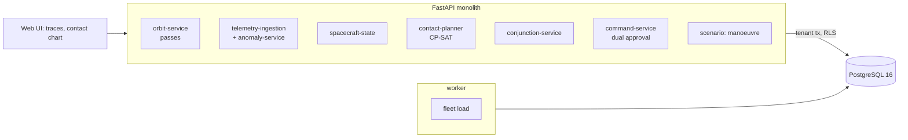

# Space Mission Operations & Satellite Fleet Management Platform

For a small-satellite operator: it keeps the state of every spacecraft and pass, notices a battery that is warming hours before a
red limit would, schedules ground-station contacts so the most important data lands before its deadline, scores a close approach,
shows whether a manoeuvre is safe to fly on the battery it will have, and releases no command without two people.

Built from blueprint 3 of "Advanced Engineering Build Book, Volume III" as a **vertical slice**: the demo scenario end to end,
with the platform parts real and the rest listed under [Not built](#not-built-and-why).

**The fleet, its orbits, its telemetry and the close approach come from a simulator in this repository. Orbits are circular
two-body, not SGP4. The collision probability uses a stated uncertainty, not a covariance message.**

## Run it

```bash
docker compose up --build        # migrates, seeds, serves http://localhost:8213/ui/ with one worker
docker compose run --rm test     # 14 tests against a throwaway database (about 10 s)
```

Open http://localhost:8213/ui/ and press **Run all steps** (about 3 seconds), or `make bootstrap demo`.
Demo tokens (local only): `fleet-director-demo`, `fleet-engineer-demo`, `fleet-operator-demo`, `fleet-viewer-demo`. Run `make reset` before a second demo run.

## The demo, step by step

1. 18:00 on day one: twelve spacecraft (eight sun-synchronous, four at 51.6°), four stations, 432 passes in 48 hours of which 272 are still ahead, 102,720 telemetry rows (18 hours x 8 metrics x 12), and 486 GB of downlink requests against 544 GB of passes ahead, before priorities, deadlines and station clashes.
2. Ten minutes of packets for RBO-07 (one sent twice). Detection compares each metric with its own normal by orbit phase, learned from the first twelve hours: the battery temperature has been off its normal since 16:01, 8.6 noise units up. The simulator started warming it at 14:00. The fixed red limit (30 °C) has not tripped and would not for hours; an Isolation Forest on the same data flags nothing.
3. Contact planning for 24 hours: 216 passes, 102 pairs of which overlap at a station. The plan uses 112 passes and delivers 449 priority-weighted GB and 3 requests in full; first come, first served delivers 409 and 2.
4. A screening message: debris 180 m from RBO-03 in 20 hours, 120 m uncertainty. Probability of collision 2.8 x 10⁻⁴, above the action threshold.
5. A 5 cm/s burn five hours before closest approach moves the spacecraft 2.7 km along track; probability falls below 10⁻⁹. But a 72-minute imaging campaign sits just before the burn: state of charge at ignition would be 56%, below the 80% rule. With the campaign moved 7 hours later it is 90%.
6. The manoeuvre command is refused while the payload plan stands (the margin rule is checked at the queue). The payload delay is queued, approved by an engineer, released by the director onto the next pass; the engineer approving a second time and the operator approving at all are refused. The manoeuvre then goes the same way, with its checksum.
7. The audit log.

## Architecture



| Piece | How it works |
|---|---|
| Simulator (`sf/world.py`) | Circular orbits propagated in Earth-centred inertial coordinates, rotated to Earth-fixed, elevation from each station; a pass is a run above 10°. Sunlight from a fixed sun vector and Earth's shadow. A power balance per minute (solar in sunlight; bus, payload and downlink loads) gives state of charge; temperatures follow sunlight and activity, with noise. A fault is a ramp on one metric. |
| Anomaly detection | Each metric's normal is its median by orbit phase over the first 12 hours, folded on the spacecraft's own period; the residual's noise comes from the same window. A metric 4 noise units off its normal for the last 10 minutes is an open anomaly. State of charge is watched by its limit only. Fixed red limits and an Isolation Forest are kept beside it for comparison. |
| Contact planner | CP-SAT over the passes in the horizon: one optional interval per pass, no overlap per station (plus a 3-minute slew) and per spacecraft, data credited only before the request's deadline, maximise priority-weighted gigabytes delivered. Solves in well under a second. First come, first served beside it. |
| Conjunction | Probability of collision from the miss distance, a combined isotropic uncertainty and a combined hard-body radius (the thin-encounter approximation). An along-track burn shifts position at closest approach by about 3 x Δv x Δt. |
| Manoeuvre scenario | The battery forecast to the approach under the payload plan as it stands and with the overlapping campaign delayed; the margin rule is 80% at ignition. |
| Commands | A command carries a checksum of its content. It needs two approvals from two different people, neither of whom queued it; the second releases it onto the next pass before its time. A manoeuvre is refused at the queue when the battery margin would not hold. |
| Platform | Row-level security per operator, Postgres job queue, Idempotency-Key replay, hash-chained audit log, `/metrics`. |

## Data model

`migrations/002_fleet.sql` follows the blueprint (spacecraft, ground_stations, passes, telemetry, commands, conjunctions); additions
are marked `(+)`: fleets (the clock), orbits (elements in place of tle_sets), anomalies, downlink_requests, contact_plans, and on each
command its second approver and uplink pass.

## API

| Method | Endpoint | Purpose |
|---|---|---|
| POST | `/v1/telemetry/packets` | Housekeeping packets; a resend stores nothing; detection runs on the whole record |
| GET | `/v1/spacecraft/{id}/state` | Latest values, state of charge, open anomalies, next passes, the downlink request |
| POST | `/v1/planning/contacts` | Schedule the passes ahead against priorities and deadlines |
| POST | `/v1/commands` | Queue a command; a manoeuvre without battery margin is refused |
| POST | `/v1/commands/{id}/approve` | One of two approvals; the second releases |
| GET | `/v1/conjunctions?risk_min=` | Close approaches at or above a probability |
| POST | `/v1/scenarios/orbit-maneuver` | Miss distance and probability after a burn; battery margin under the current and a delayed payload plan |
| POST | `/v1/fleet:load` | (+) 202 + job: load a synthetic fleet |
| POST | `/v1/conjunctions` | (+) Register a screening message |
| GET | `/v1/commands` | (+) The queue |

Contract: [`docs/openapi.json`](docs/openapi.json).

## Measured

[`docs/evaluation.md`](docs/evaluation.md) (`python -m sf.evaluate`, three fleets the demo never uses: 108 injected faults, 36 clean
records, 12 request queues) and [`docs/performance.md`](docs/performance.md).

| Component | Result | Baseline |
|---|---|---|
| Slow drifts caught within 36 hours | 108 of 108, a median 140 to 195 minutes after onset | fixed red limits: 36 of 108, a median 10 to 13 hours; Isolation Forest: 0 |
| Alarms on 36 clean records | 0 | red limits: 0; Isolation Forest: 5 |
| Wrong metric flagged alongside a fault | 0 | |
| Priority-weighted data delivered | 9.6% more than first come, first served | |
| Requests met in full, 12 queues | 11 | first come: 18 |

Two things these numbers say plainly. Detection is the strong part, and it is a statistical test, not a learned model: the Isolation
Forest the blueprint suggests never fired on a slow drift of one metric, because a minute of eight ordinary-looking values is not
an outlier. The contact planner is told to maximise priority-weighted gigabytes, and it does, at the cost of completing fewer
requests than first come, first served: the objective decides, and a different mission would weight completion instead.

## The hardest tradeoff

The first version of the detector folded telemetry on a fixed 95-minute period and reported any 10-minute excursion since the
learning window. On 36 clean spacecraft it raised 95 alarms. Two causes: each orbit's true period differs from 95 minutes by up to
a minute, so after a day the fold was off by a quarter of an orbit and the sunlight swing itself looked anomalous; and a payload
burst drifting against the phase bins left a past excursion on record forever. The fix was to fold on each spacecraft's own period
and to report only what is off its normal right now. Zero alarms on clean records, every drift still caught. The remaining price is
in the evaluation: about two to three hours from onset to alarm, because the rule waits for ten minutes of persistence at four noise
units. A fleet that would rather chase false alarms than wait would set both lower; they are named constants.

## Threat model (summary)

| Threat | Mitigation here | Gap |
|---|---|---|
| A command released by one person, or by the person who wrote it | Two approvals from two different actors, neither the author; the operator role cannot approve at all | No independent verification of the command content against the scenario |
| A manoeuvre flown on a battery that cannot take it | The margin rule is checked when the command is queued, against the payload plan as it stands | The forecast is the simulator's own power model |
| Tampered or replayed packets | Primary key on spacecraft, time and metric; packets outside the record window are refused; Idempotency-Key replay returns the stored response | No packet authentication or CCSDS framing |
| One operator seeing another's fleet | Row-level security on every table; tested through the API and directly in the database | |
| Over-trusting a collision probability | The method and its stated uncertainty are returned with every score | No covariance, no secondary-object uncertainty |

## Not built, and why

- **SGP4 and TLEs**: orbits are circles from stored elements; no drag, no J2, no real catalogue.
- **CCSDS packets and a ground-station network**: packets are JSON over HTTP; the uplink is a status change and a pass number, nothing is radiated.
- **Sequence models for battery forecasting**: the forecast is the power balance played forward; the blueprint's autoencoder/Isolation Forest is measured and found wanting for slow drifts.
- **Mission scheduler for payload jobs**: the payload plan is a fixed pattern plus one campaign; a delay command moves one operation.
- **Covariance-aware conjunction screening**: an isotropic sigma stands in for the covariance a CDM would carry.
- **Kafka, Redis, OpenTelemetry, Grafana, MLflow, Terraform, CI, SSO, a Next.js front end**: not needed to prove the slice; no cloud account used.

## Commercial sketch

Buyer: small-satellite operators and mission integrators. Pricing shape from the blueprint: per spacecraft a month, plus
scheduling API usage, with assurance and audit tiers.

## Layout

```
core/        platform kit: db + RLS, jobs, audit chain, HTTP, scenario runner, load test
sf/          world (orbits, passes, telemetry, conjunction), engine (detection, planner, forecasts), api, seed, evaluate
migrations/  forward-only SQL          web/   UI, scenario.json, demo.json (recorded run)
tests/       14 tests                  docs/  evaluation.md, performance.md, openapi.json
```
